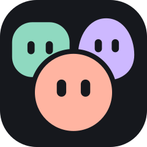
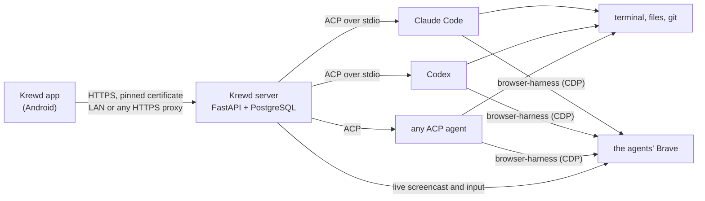

<p align="center">
  
</p>

<h1 align="center">Krewd</h1>

<p align="center">
  <b>Your own crew of AI agents, on your own machine, in your pocket.</b><br>
  Ask from your phone. Claude Code, Codex or any ACP agent does the work on your server,
  with a real terminal and a real browser, and asks you before anything that matters.
</p>

<p align="center">
  <a href="LICENSE"></a>
  
  
  
</p>

<!-- Demo video and screenshots: docs/media/ (added with the launch). -->

## Why Krewd

Coding agents became general agents: they can read, browse, run code and finish real work. But they
live in a terminal on a desk. Krewd puts them on a machine you own and gives you a phone app to run
them from anywhere.

- **Real agents, not a chatbot.** Each task runs a full coding agent with your server's terminal,
  files, git and its own Brave browser. It can fix a failing build, compare prices across shops,
  fill a long form or research a topic across twenty sites.
- **Agent-agnostic.** Claude Code and Codex work today; any agent that speaks the
  [Agent Client Protocol](https://agentclientprotocol.com) can be added in a few lines of TOML. Switch
  agents in the middle of a chat: the outgoing one writes a handover, the next one picks up.
- **Self-hosted.** Your data, logins and history stay on your hardware, in your own PostgreSQL.
  Run agents on their own subscriptions or through any gateway (OpenRouter, a company proxy).
- **You stay in charge.** Agents ask before they submit, send, pay, book or delete. You approve on
  the card, from the lock screen if you like.

## What it does

- **Tasks from your phone.** Type or attach files; watch live steps, a timer and the agent's
  current browser tab on the task card. Steer a running agent, queue the next message, or stop it.
- **A live window into the agents' browser.** Watch the exact tab an agent works in at up to
  60 fps, and take over with touch, a trackpad cursor and your keyboard when it needs a hand (a
  CAPTCHA, a choice). Picture-in-picture keeps it on screen inside a chat.
- **Routines that think.** Not reminders: real agent runs on a schedule. Several named triggers per
  routine, bounded retries ("not yet, try again in 5 minutes"), notes the agent keeps for its next
  run, and one chat per routine to review every run. Agents create and manage routines themselves
  with the `krewd` command, and ask before they do.
- **Sign-ins without sharing passwords.** When a site needs a login, the agent asks; you fill it in a
  secure sheet on the phone (your password manager offers the saved login) and Krewd types it into
  the page. The agent never sees it, and nothing is stored or logged.
- **Hardware-key security.** Phones pair with your FIDO security key (USB-C or NFC). Keys and
  sign-ins need your fingerprint. HTTPS everywhere with Krewd's own pinned certificate; one QR code
  connects a new phone.
- **Files both ways.** Attach anything to a task; agents hand files back as downloads.
- **Your agents' own commands and skills.** The composer suggests each agent's slash commands and
  skills as you type.
- **Live notifications.** Android 16 live updates for running tasks, plus alerts when an agent needs
  you, finishes or fails.

## How it works



- **Server** (`server/`, Python 3.12, FastAPI, asyncpg): one ACP process per agent, a durable event
  log in PostgreSQL (the phone can drop off at any moment and catch up), approvals, routines, the
  browser bridge and security.
- **App** (`android/`, Kotlin, Jetpack Compose): tasks, chats, routines, the live browser and settings.
- **Agents**: whatever `~/.config/krewd/engines.toml` lists. Instructions come from `AGENTS.md`, skills
  from `~/.agents/skills`, the browser through [browser-harness](https://github.com/browser-use/browser-harness).

## Get started

You need a Linux machine with systemd and a desktop session, PostgreSQL 14+, [uv](https://docs.astral.sh/uv/),
Brave, and at least one ACP agent (for Claude Code, the standalone `claude-agent-acp`).

```bash
git clone https://github.com/zainbits/krewd.git && cd krewd
./master.sh setup     # config, Python environment, systemd user units, then a health check
./master.sh token     # QR code to connect the phone
```

Build and install the app with `./master.sh app`, scan the QR code, then pair the phone with your
security key in Settings > Security. `./master.sh doctor` checks everything and says how to fix
what it finds. The full guide for people and coding agents is [AGENTS.md](AGENTS.md); the HTTP API
is in [docs/api.md](docs/api.md).

## Status

Krewd is young and moving fast. It runs every day on its author's home server. Expect breaking
changes before 1.0; the one version for server and app is in [`VERSION`](VERSION).

## Contributing and security

Issues and pull requests are welcome. Read [AGENTS.md](AGENTS.md) first: it is the guide for humans
and coding agents alike. Please report vulnerabilities privately, as described in [SECURITY.md](SECURITY.md).

## License

[Apache License 2.0](LICENSE). "Krewd" and the crew faces are the project's name and marks.
